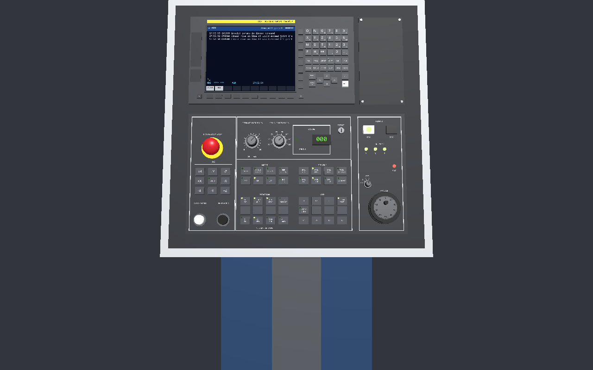
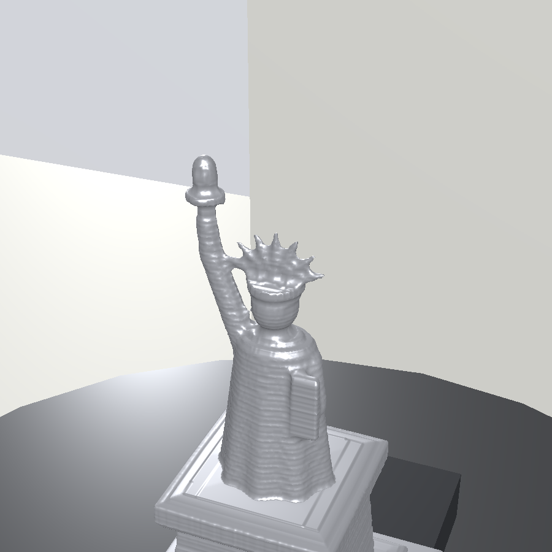
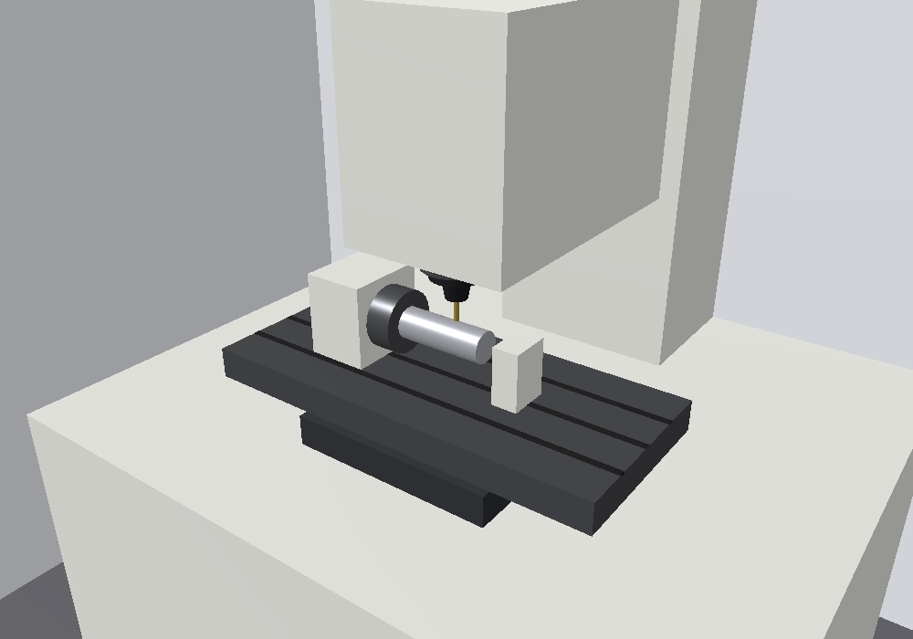
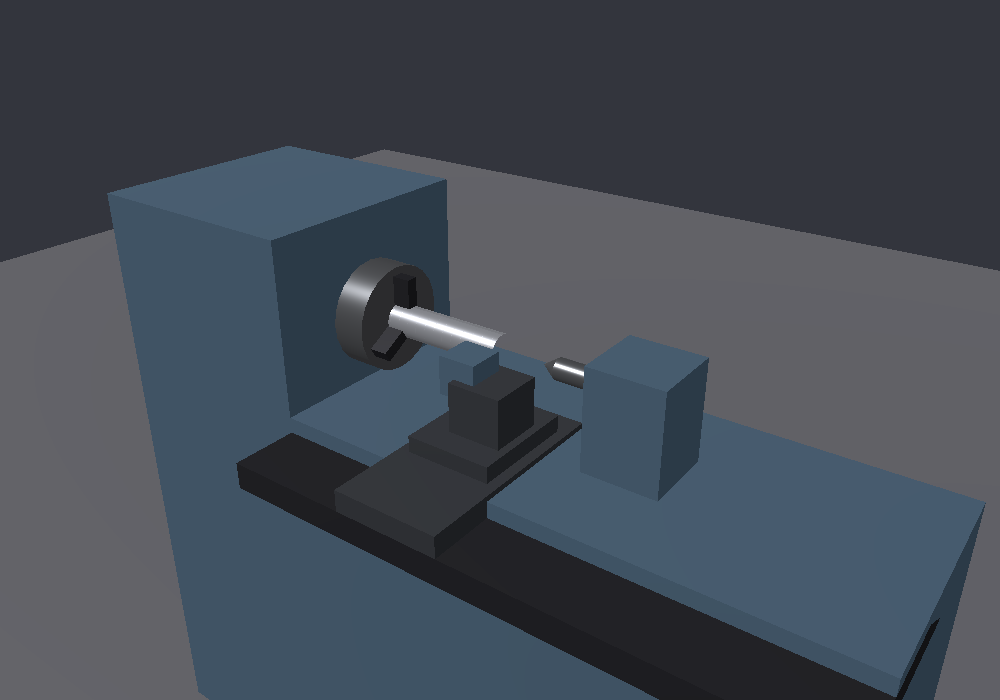
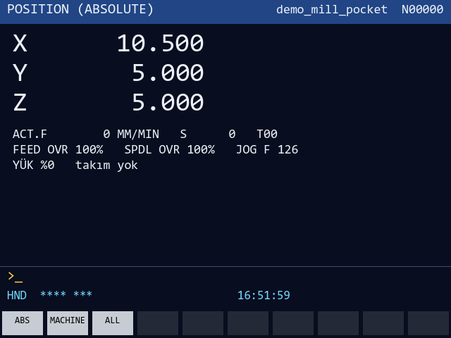
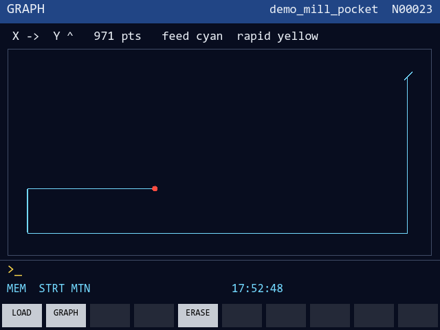
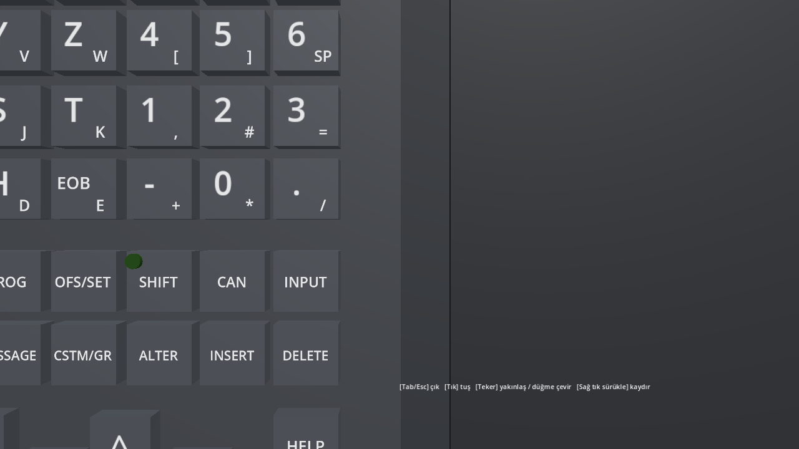

# CNC Operator Training Simulator (Godot + LinuxCNC)

A first-person CNC training simulator. A real **LinuxCNC** instance (running
in WSL2) is each machine's brain: it interprets the G-code, plans the motion,
enforces limits and raises the alarms. **Godot 4 (C#)** is the workshop around
it: the machines, the control pendant, the material being cut, the tools in
your hands.

The goal is to train operators on what they actually do at a machine — pick
the stock, bolt the fixture down, clamp the part, load and measure the tools,
find the work zero, run the program at the control — and to show what happens
when a step is skipped.

| | |
|---|---|
|  |  |
| The control pendant at every machine: screen, MDI keypad, operator panel, handwheel | A part carved by a 38,000-line 3+2 program on the 5-axis trunnion |
|  |  |
| A vise bolted down by hand, stock on parallels, one bolt still missing | Stock station: shape, size, material, live preview |

More in [`docs/screenshots/`](docs/screenshots/).

## What is in it

- **Live machines.** Each machine runs its own LinuxCNC in WSL, all in one
  distro (isolated from each other by Linux namespaces); Godot only sends
  commands and draws what LinuxCNC reports. Positions are predicted between
  packets for smooth motion; material is only ever removed from confirmed
  positions.
- **The control.** Every machine has a pendant in the style of a 0i-F Plus
  control, laid out from a photo of a real one and operated by clicking its
  keys: mode keys, jog keys, handwheel, feed / spindle / rapid overrides,
  cycle start, feed hold, emergency stop. The screen has the usual pages —
  position, program, program directory and editing, MDI, tool and work
  offsets, alarms with Fanuc-style codes, a tool-path graph.
- **Material removal.** Lathes cut a radius profile; mills cut a voxel stock
  that works in any tool orientation, so 4- and 5-axis parts come out right.
  Parted-off lathe parts become objects you can pick up and measure.
- **Hands-on setup.** A stock station makes the blank you ask for; you carry
  it to the machine, bolt the vise to the T-slots (or clamp the part, or use a
  centring plate or chuck), tram it with a dial indicator, load tools into the
  spindle or turret, measure them, and find the work zero with an edge finder
  and a slip of paper. The stock is cut where it really sits.
- **Cutting physics and consequences.** Spindle power and tool force follow
  the removal rate: overload stalls the spindle, a tool pushed too hard snaps,
  tools wear (slower with coolant) and cut oversize. A loosely clamped part is
  thrown out, a rapid into material or a holder into the stock is a crash and
  costs the machine its reference, a key left in the chuck flies out, an open
  door blocks the cycle.
- **Measuring.** Caliper, micrometer and depth gauge read the real cut
  surface — on the machine and on finished parts.
- **Sound.** Key clicks, alarm beeps, spindle motor, cutting, axis servos and
  coolant, all synthesised and placed in 3D.
- **Machine generator** (editor plugin). Describe a machine — axes, travels,
  tools, table, frame, chuck, turret — and get its scene and its LinuxCNC
  configuration. Nine presets from a benchtop mill to a 5-axis trunnion.

| | | |
|---|---|---|
|  |  |  |
|  |  |  |

Machines are built from primitives by code; there are no imported models.

## Setup (once per computer)

Windows with WSL2 only: LinuxCNC has no Windows port.

1. **WSL2 + Ubuntu 26.04.** `wsl --update`, then `wsl --install -d Ubuntu`.
   (Ubuntu 24.04 does not carry the LinuxCNC package.)
2. **LinuxCNC inside it:**
   ```
   wsl -d Ubuntu -- sudo apt-get update
   wsl -d Ubuntu -- sudo apt-get install -y linuxcnc-uspace linuxcnc-uspace-dev python3-pip
   ```
3. **.NET SDK 8+** and **Godot 4.7+ (.NET build)** on Windows. Point
   `$GodotExe` at the top of `start.ps1` at your Godot executable.

No firewall rule or fixed IP is needed; see "Networking" below.

## Running

```
.\start.ps1
```

or open the project in the Godot editor and press Play. Godot starts each
machine's LinuxCNC and bridge in WSL itself and stops them when the window
closes. The first start can take up to 90 seconds before a machine's screen
shows live data.

### Controls

| Key | Action |
|---|---|
| W A S D, Shift, Space | walk, run, jump |
| Mouse | look |
| Right mouse (hold) | zoom |
| Ctrl (hold) / C | crouch |
| Q / R | lean left / right |
| Left Alt + mouse | move the head (peek into a machine); Alt + wheel: head forward / back; tap Alt to bring it back |
| V | first / third person |
| F | pick up / drop what you are looking at |
| Left click | use, place, press a console key |
| Mouse wheel | turn a bolt, the vise screw, a dial or the handwheel |
| E or Tab | at a console: close-up on the panel; at the stock station: its panel |
| Esc | free / capture the mouse |
| F2 | debug: 2D operator panel and status text |
| F3 | debug overlay |

In the console close-up the mouse is free: click keys (hold a jog key to
keep moving), turn dials with the wheel, wheel elsewhere zooms toward the
cursor so the small legends become readable, right-drag pans, E / Tab / Esc
leaves.

| | |
|---|---|
|  |  |
| POS page | CSTM/GR > GRAPH: the tool path as it is cut |



### Using the control

- **Start:** POWER **ON**, then **REF RETURN** and **ALL REF** (or an axis key
  for one axis). The REF POINT lamps light per axis.
- **Jog:** **JOG** and hold an axis key (speed from the feedrate dial,
  **RAPID** for fast); **INC JOG** with a step from x1 to x1000; **HANDLE**:
  pick the axis on the AXIS knob and turn the handwheel.
- **MDI:** **MDI**, type a block (`G0X10Z5`; EOB separates blocks, SHIFT + 6
  is a space), **INSERT**, **CYCLE START**.
- **Programs:** **PROG**, softkey **DIR**, cursor to a file, **SELECT**.
  **AUTO** + **CYCLE START** runs it; **FEED HOLD** pauses, **CYCLE START**
  resumes (in MDI too), **RESET** stops. **SINGLE BLOCK**, **BLOCK SKIP**,
  **OPT STOP** and the rapid override keys work as on a real control;
  **PRG RESTART** starts from the line under the PROG cursor.
- **Checking a program:** **CSTM/GR > GRAPH** draws the whole selected
  program (dim) under the path being cut and checks it against the vise,
  clamps, table or chuck as they sit now: the first crash is marked with a
  red cross and its line number (`CRASH N26: ...`). **MC LOCK** runs it without moving
  the machine: the screen counts, nothing cuts or collides. Releasing the
  lock after the control moved costs the reference (**ALL REF** again), as on
  a real control.
- **Editing:** **EDIT**, cursor to a line, type, then **INSERT** (new line
  after the cursor), **ALTER** (replace) or **DELETE**. The edited program
  runs as a copy beside the original (`nc_files/_edit_<name>.ngc`); the
  original file is not changed.
- **Tool changes:** every M6 waits until you put the tool in by hand and press
  **TOOL CHG END**.
- **Offsets:** **OFS/SET**. TOOL view is the tool offset table (every tool,
  GEOM and WEAR, diameter / nose radius): ^ v pick the tool, < > the column.
  **INPUT** sets the value under the cursor, **+INPUT** adds to it (type
  `-0.02`, +INPUT on WEAR after a part measures 0.02 big). **MEASURE** works
  on the tool in the spindle: on a lathe the measured diameter for X and the
  face position for Z, on a mill the Z of the surface under the tool; it sets
  the geometry and keeps the wear. WORK view: type the coordinate of
  the spot the tool is at and **MEASURE** sets G54 (or **INPUT** to type the
  offset itself). The cursor or a leading axis letter (`X48`) picks the axis.
- **Alarms:** **MESSAGE** lists them (`OT0500` overtravel, `PS0224` not
  referenced, `EX10xx` setup and crash alarms); the ALM lamp blinks until
  **RESET** or **ALARM RESET**.

### Setting up a part on the mill

A setup sheet on the right of the screen ticks each step off.

1. Stock station: **E**, choose shape, size and material, **ÜRET**. Pick the
   blank up with **F**.
2. Take the vise from the cart beside the machine and click the table.
3. Bring the four bolts one by one and click each hole; then, holding the
   T-handle hex key, turn each with the mouse wheel until snug.
4. Tram: hold the dial indicator over the fixed jaw, tap the vise with the
   mallet until the run-out is small, then tighten the bolts.
5. Parallels: pick them up, click the vise.
6. With the vise handle, open the jaws wide enough; click the vise with the
   blank in hand; tighten with the wheel to 3/3; tap with the mallet.
7. Tools: take them from the blue tool cart, check each on its length gauge,
   load the first into the spindle. On the gauge the wheel slides a cutter in
   its collet: shorter chatters less but reaches less deep; measure it again
   after.
8. Work zero at the control, by touch probe: MDI `T8 M6`, `G43`, above the
   part `G38.2 Z-10 F100`, then **OFS/SET > WORK**, `Z0`, **MEASURE**. A
   side: `G38.2 Y-30 F50` from outside it, then the edge's coordinate less
   the 2 mm ball radius (`Y-42` for an edge at Y-40), **MEASURE**. Driving the probe in with G0/G1 stops the
   control (or breaks the stylus).
   For tool lengths without paper, the **Z setting block** (50.000 mm) on the
   bench: stand it on the part, step down until it is snug, type `Z50`,
   **MEASURE**.
   Or by hand: MDI `T9 M6` (edge finder, then TOOL CHG END),
   **HANDLE**, creep up to the left edge until the finder kicks; **OFS/SET >
   WORK**, type `X-5`, **MEASURE**. Same for Y. Then the cutter, hold the
   paper gauge under it, step down until the paper drags, type `Z0.05`,
   **MEASURE**.

A vise at 2/3 holds the part, but it creeps under the cut and the sizes
come out wrong: only the report card (or your own measuring) tells you.

### Lathe jaws

The chuck starts with hard jaws. The jaw rack left of the lathe control
holds two more sets, every jaw numbered. To change them, empty the chuck,
put the key in and open the jaws all the way; turning on runs them off the
scroll one at a time (3, 2, 1), each into your hand: put it down before the
next. To fit a set, turn the key until the scroll's thread starts at slot 1
(the prompt says where it is), click with jaw 1, turn on to slot 2, jaw 2,
and so on. A jaw in the wrong slot, or one caught a turn late, holds the part
millimetres off: closed right in, such jaws do not meet at the centre.
**Reversed** hard jaws take big parts but do not close on small ones;
**soft** jaws only hold a part once bored for it (click the chuck with the
part in hand), and then it runs nearly true. A bar sticking out more than
four diameters chatters; the setup sheet warns.

A bored part can be held **from inside** (ID gripping) on the hard jaws:
close them smaller than the bore, slide the part over them bore first, then
the key **opens** the jaws out against the bore and tightens. The whole
outside is free to turn; the bore must be at least 15 mm deep.

### Chucks

Two more chucks stand on the floor by the jaw rack, each with its own size
(a lathe refuses one that would hit its bed). To change: empty the chuck,
take the key out, then with the **cam key** (on the rack) wheel back to undo
the three cam locks; click the chuck with the other one in hand (the old one,
with its jaws, comes off into your hands); wheel the cam key forward to lock
the three cams again. Starting the spindle with a cam undone throws the
chuck. The work now sits as far out as the new chuck is long.
The **4-jaw independent** chuck seats a bar well off centre, then the mallet
(with the dial on the bar) adjusts one jaw against the other, also when
tight, down to microns; its jaws go in any order. The **ER32 collet** chuck
takes one collet at a time from the box on the rack (each holds its size to
1 mm under): collet in, bar in, key to tighten; loosened, the bar slides.
Each chuck has its own speed limit; going faster is warned.

### Fanuc-style tool calls

A lathe with a disc turret can take Fanuc calls: set `ToolCalls` to
`FanucTurret` in its MachineSpec. `T0101` then indexes station 1 and applies
offset 1 in one word, and the turret turns by itself (no TOOL CHG END). See
`nc_files/lathe_kademeli_mil_fanuc.ngc`. Under it a bare `T1` means offset 1
on station 0, so a machine uses one style or the other.

### Work orders

The work order board (**İŞ EMİRLERİ**): the wheel leafs through the orders,
a click takes one. Its card stays top left (material, stock, program and
every toleranced size) and its technical drawing bottom left. Make the part, then put it on the quality control
table (**KALİTE KONTROL**): the report card lists each size as measured, the
material, the surface roughness, any incident since the order was taken, a
score and where to look first when it fails. Orders are `.tres` files under
`Machines/WorkOrders/` (edit them in the inspector: every field explains
itself); a new file shows up on the board by itself.

## Generating a machine

**Project > Tools > CNC Machine Generator** opens a dock: pick a preset, edit
it in the embedded inspector while the 3D preview follows, fix what the
problem list reports, **Generate Machine Scene**. This writes
`Scenes/Machines/<Name>.tscn`; its LinuxCNC files
(`linuxcnc-config/gen_<Name>.ini/.tbl`) are rewritten from the spec at every
start. A placed machine stays editable through its `Spec` in the Inspector.

- **Axes**: letter, limits, speed, home, and whether the axis carries the
  tool or the workpiece. For mills the list order is the kinematic chain.
- **Tools**: number, kind, diameter, corner/nose radius, length, flutes.
- **Structure**: frame, table, workholding, stock (mill); bed, slide angle,
  chuck, turret, tailstock, stock (lathe); spindle power.
- **Manual Setup**: the machine starts empty and the player sets it up.

## Programs

Programs live in `linuxcnc-config/nc_files/` and are picked on the control
(**PROG > DIR**). A file saved while the game runs shows up without a restart.
The demo programs cover turning, milling, a multi-tool VMC part, a 4-axis and
a 5-axis part; `tools/statue_cam.py` generates the statue program.

When writing your own: tool numbers must exist in the machine's tool list;
put `G43` after every `Tn M6` on a mill (tool lengths are real: the control's
Z is the spindle gauge line, so without G43 the tip goes a whole tool length
below the programmed Z — set `Tool Length Reference` to `NominalToolTip` in a
machine's Mill structure for the forgiving older model); moves must
stay inside the axis limits; on 4/5-axis machines there is no
tool-centre-point control, so coordinates are plain machine axes.

## Networking

- **State, bridge -> Godot.** Godot sends a SUBSCRIBE packet once a second;
  the bridge streams state back to that packet's source. To a firewall the
  stream is a reply to Godot's own traffic, so no inbound rule is needed.
- **Commands, Godot -> bridge.** WSL2's `127.0.0.1` forwarding does not work
  for UDP on at least some builds, so the bridge writes its own address to
  `bridge/.bridge_endpoint` and Godot reads it.
- All machines share one address: each needs its own port pair.

## Tests

```
dotnet test tests/Tests.csproj
wsl -d Ubuntu -- python3 -m pytest /mnt/c/<path-to-repo>/tests/bridge/ -v
```

Do not run the Python LinuxCNC tests (`test_linuxcnc_process.py`,
`test_preview.py`) while the game is running: they start their own LinuxCNC
and stop the game's.

## Layout

```
bridge/                  Python bridge: LinuxCNC lifecycle, protocol, state, commands
linuxcnc-config/         hand-written sim configs, demo programs (nc_files/)
addons/cnc_machine_generator/   the editor plugin
Scripts/
  Bridge/                UDP client, protocol mirror, machine state
  Machines/              machine roots, cutting, safety, offsets, Spec/ (machine
                         description, presets, LinuxCNC config writer, kinematics)
  Machining/             cutting load, tool wear, physical tools and sockets
  MachineVisual/         control pendant (ConsoleStand, its screen and dials),
                         procedural mill and lathe bodies, tool meshes
  Material/              lathe radius profile, voxel stock and mesher
  Fixtures/              vise, clamps, centring plate, chucks, mill / lathe setup
  Workshop/              stock station, stock items, tool bench and carts
  Interaction/           what the player can look at, carry, use and measure
  Player/                player, posture, console close-up
  Audio/                 synthesised sounds, machine audio
  Panel/                 the debug 2D operator panel (F2)
  Inspection/            work orders, the job board, the inspection table, part measuring
  Chips/, Sim/, Scheduling/
Scenes/                  Main.tscn (workshop), Machines/, Workshop/, UI/
tests/                   C# (xUnit) and Python (pytest)
tools/                   record_replay.py, statue_cam.py
docs/screenshots/        images used here
PLAN.md                  current status, open work, environment gotchas
```

## Status and limits

Working: everything above. The drawing on a work order is a text card, not
a drawn 2D drawing yet.

- Kinematics are plain trivkins (no tool-centre-point control); lathes are
  X/Z only.
- PRG RESTART uses LinuxCNC's run-from-line: the tool change and spindle
  start before that line are not replayed.
- The cut state lives in Godot's memory and is lost when the game closes.
- Chips are simple pooled boxes, sized up to be visible.

`PLAN.md` holds the current status and open work.
