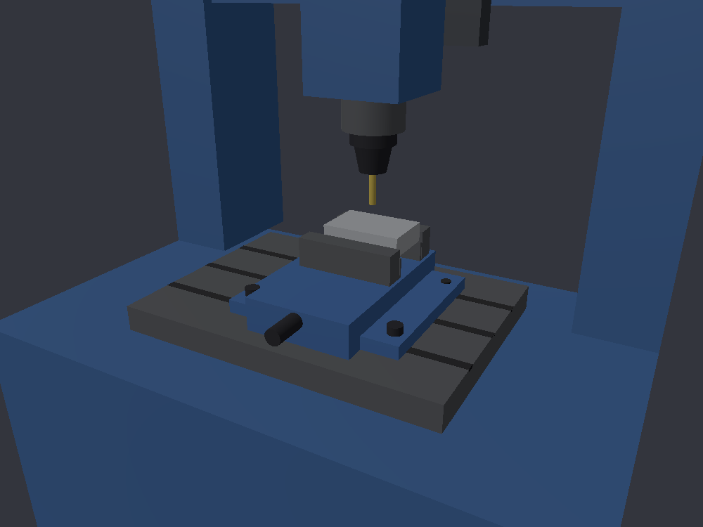
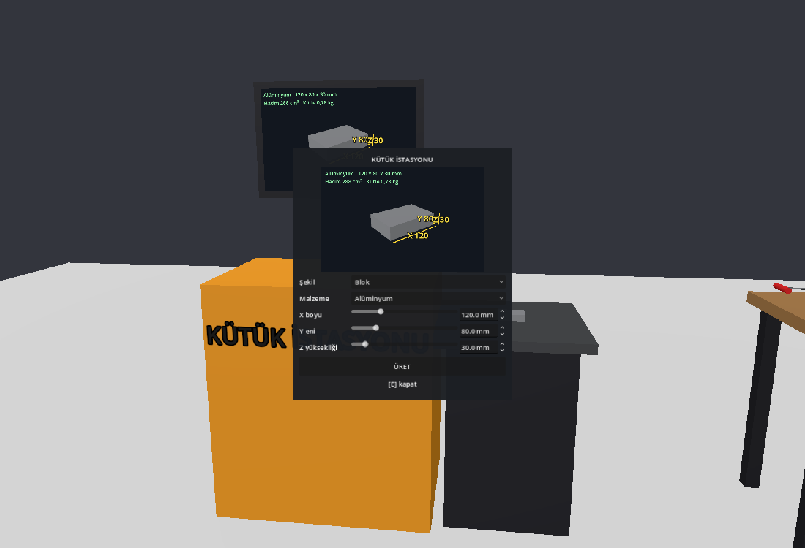
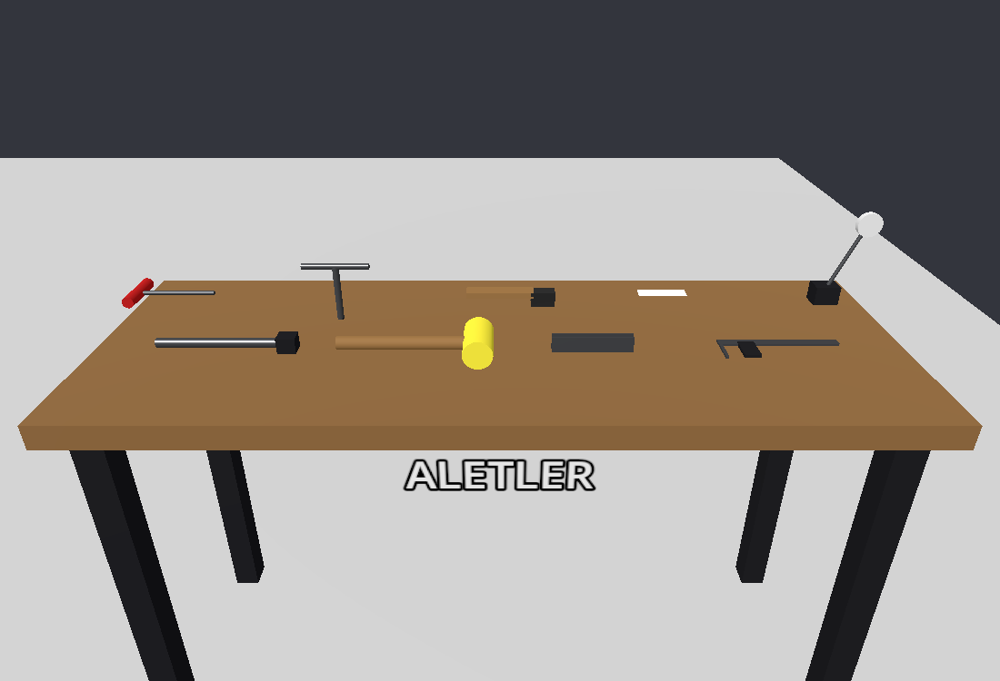
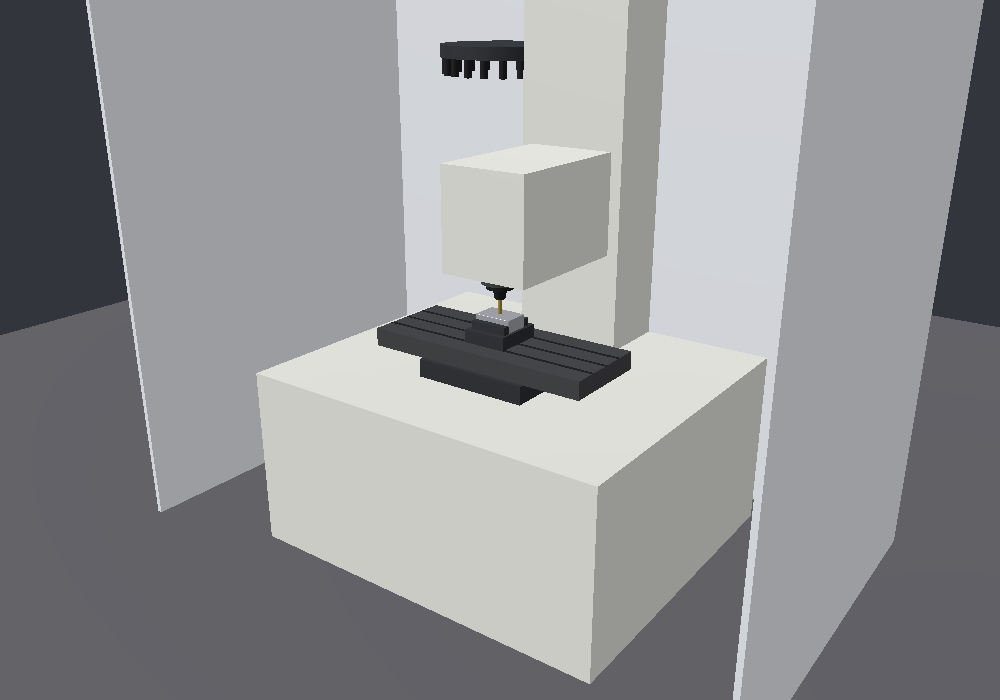
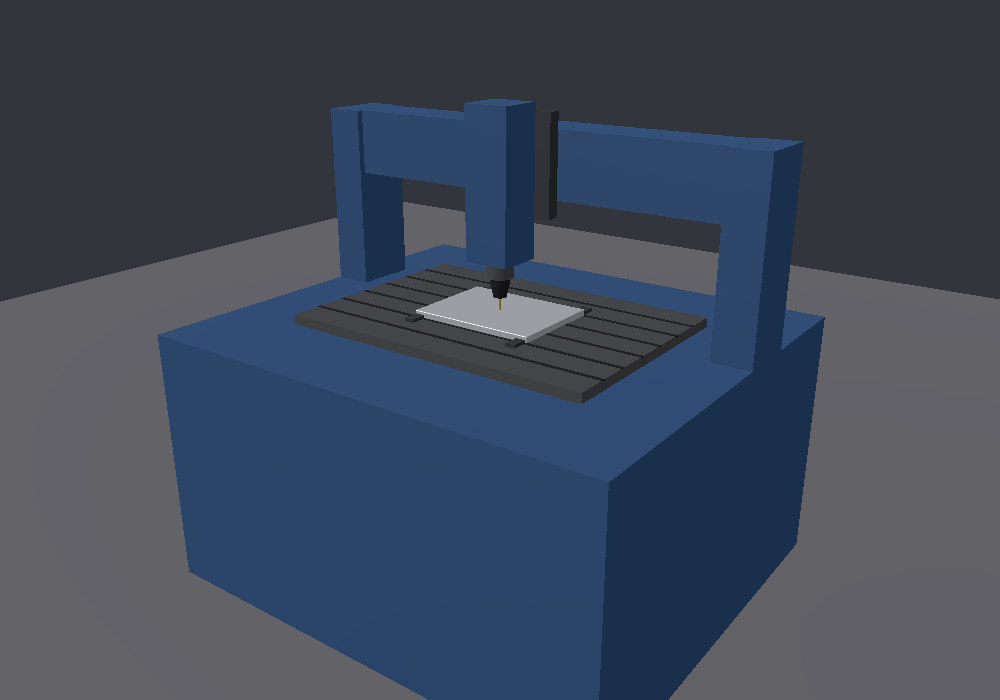
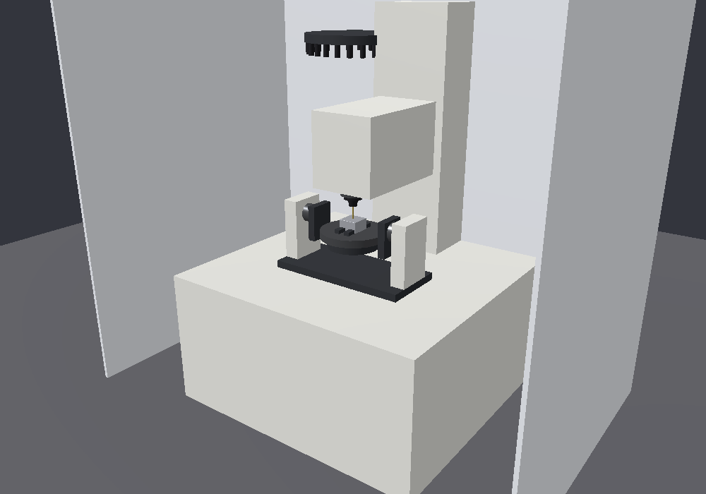
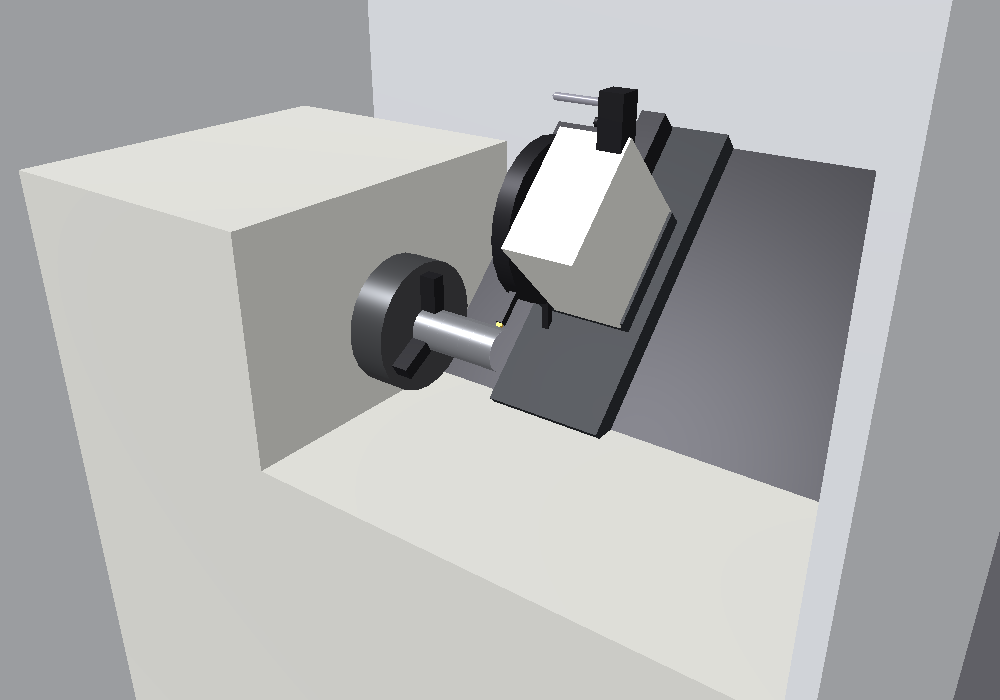

# CNC Operator Training Simulator (Godot + LinuxCNC)

A first-person CNC training simulator. A real **LinuxCNC** instance (running
in WSL2) is each machine's brain: it interprets the G-code, plans the motion,
enforces limits and raises the alarms. **Godot 4 (C#)** is the workshop around
it: the machines, the material being cut, the tools in your hands.

The goal is to train operators on what they actually do at a machine — pick
the stock, bolt the fixture down, clamp the part, find the work zero, run the
program — and to show what happens when a step is skipped.

| | |
|---|---|
|  |  |
| A part carved by a 38,000-line 3+2 program on the 5-axis trunnion | A vise bolted down by hand, stock on parallels, one bolt still missing |
|  |  |
| Stock station: shape, size, material, live preview | The hand tools every setup step asks for |

More in [`docs/screenshots/`](docs/screenshots/).

## What is in it

- **Live machines.** Each machine runs its own LinuxCNC in WSL, all in one
  distro (isolated from each other by Linux namespaces); Godot only
  sends commands and draws what LinuxCNC reports. Positions are predicted
  between packets for smooth motion; material is only ever removed from
  confirmed positions.
- **Material removal.** Lathes cut a radius profile; mills cut a voxel stock
  that works in any tool orientation, so 4- and 5-axis parts come out right.
  Parted-off lathe parts become objects you can pick up.
- **Machine generator** (editor plugin). Describe a machine — axes, travels,
  tools, table, frame, chuck, turret — and get its scene and its LinuxCNC
  configuration. Nine presets from a benchtop mill to a 5-axis trunnion.
- **Hands-on setup.** A stock station makes the blank you ask for; you carry
  it to the machine, bolt the vise to the T-slots one bolt at a time, set
  parallels, clamp, seat the part with a mallet, then find the work zero with
  an edge finder and a slip of paper. The stock is cut where it really sits.
- **Consequences.** Cut a loosely clamped part and it is thrown out and the
  machine stops. Skip the parallels and the cutter runs into the jaw. Push
  the edge finder too far and it breaks.
- **Operator controls.** A 3D console at each machine and a 2D panel: modes,
  jog, MDI, program load, cycle start/hold/stop, overrides, tool change
  confirm, tool touch-off, work-zero buttons, work and machine coordinates.

| | | |
|---|---|---|
|  |  |  |
|  |  |  |

Machines are built from primitives by code; there are no imported models.

## Setup (once per computer)

Windows with WSL2 only: LinuxCNC has no Windows port.

1. **WSL2 + Ubuntu 26.04.** `wsl --update`, then `wsl --install -d Ubuntu`.
   (Ubuntu 24.04 does not carry the LinuxCNC package.)
2. **LinuxCNC inside it:**
   ```
   wsl -d Ubuntu -- sudo apt-get update
   wsl -d Ubuntu -- sudo apt-get install -y linuxcnc-uspace linuxcnc-uspace-dev python3-pip
   ```
3. **.NET SDK 8+** and **Godot 4.7+ (.NET build)** on Windows. Point
   `$GodotExe` at the top of `start.ps1` at your Godot executable.

No firewall rule or fixed IP is needed; see "Networking" below.

## Running

```
.\start.ps1
```

or open the project in the Godot editor and press Play. Godot starts each
machine's LinuxCNC and bridge in WSL itself and stops them when the window
closes. The first start can take up to 90 seconds before a machine reports
CONNECTED.

### Controls

| Key | Action |
|---|---|
| W A S D, Shift, Space | walk, run, jump |
| Mouse | look |
| V | first / third person |
| F | pick up / drop what you are looking at |
| Left click | use, place, press a console button |
| Mouse wheel | turn a bolt or the vise screw (with the right tool in hand) |
| Right mouse (hold) | zoom |
| Ctrl (hold) / C | crouch |
| Q / R | lean left / right |
| Left Alt + mouse | move the head (peek into a machine); Alt + wheel: head forward / back; tap Alt to bring it back |
| E | at a console: 2D operator panel; at the stock station: its panel |
| Tab | at a console: close-up on the panel (mouse clicks keys, wheel zooms to the cursor or turns a dial, right-drag pans, Tab / Esc leaves) |
| Esc | free / capture the mouse |
| F3 | debug overlay |

### Running a program

At a machine's console press **E**, then on the panel: **ON**, **HOME ALL**,
**LOAD PROGRAM**, **CYCLE START**. Every tool change waits for
**CONFIRM TC**. Jogging needs **MANUAL** mode. LinuxCNC's own error messages
appear in red in the middle of the screen.

### Setting up a part on the mill

A setup sheet on the right of the screen ticks each step off.

1. Stock station: **E**, choose shape, size and material, **ÜRET**. Pick the
   blank up with **F**.
2. Take the vise from the cart beside the machine and click the table.
3. Bring the four bolts one by one and click each hole; then, holding the
   T-handle hex key, turn each with the mouse wheel until tight.
4. Parallels: pick them up, click the vise.
5. With the vise handle, open the jaws wide enough; click the vise with the
   blank in hand; tighten with the wheel to 3/3; tap with the mallet.
6. Work zero: MDI `T9 M6` (edge finder), **MANUAL**, jog in small steps to
   the left edge until it kicks, type the X of that spot (`-5` for zero on
   the edge), **SET X**. Same for Y. Then `T1 M6`, hold the paper gauge, step
   down until the paper drags, type `0.05`, **SET Z**.

## Generating a machine

**Project > Tools > CNC Machine Generator** opens a dock: pick a preset, edit
it in the embedded inspector while the 3D preview follows, fix what the
problem list reports, **Generate Machine Scene**. This writes
`Scenes/Machines/<Name>.tscn`; its LinuxCNC files
(`linuxcnc-config/gen_<Name>.ini/.tbl`) are rewritten from the spec at every
start. A placed machine stays editable through its `Spec` in the Inspector.

- **Axes**: letter, limits, speed, home, and whether the axis carries the
  tool or the workpiece. For mills the list order is the kinematic chain.
- **Tools**: number, kind, diameter, corner/nose radius, length.
- **Structure**: frame, table, workholding, stock (mill); bed, slide angle,
  chuck, turret, tailstock, stock (lathe).
- **Manual Setup**: the machine starts empty and the player sets it up.

## Programs

Programs live in `linuxcnc-config/nc_files/` and are loaded by path
(`nc_files/name.ngc`). A file saved while the game runs can be loaded
without restarting. Eleven demo programs cover turning, milling, a multi-tool
VMC part, a 4-axis and a 5-axis part; `tools/statue_cam.py` generates the
statue program.

When writing your own: tool numbers must exist in the machine's tool list;
moves must stay inside the axis limits; on 4/5-axis machines there is no
tool-centre-point control, so coordinates are plain machine axes.

## Networking

- **State, bridge -> Godot.** Godot sends a SUBSCRIBE packet once a second;
  the bridge streams state back to that packet's source. To a firewall the
  stream is a reply to Godot's own traffic, so no inbound rule is needed.
- **Commands, Godot -> bridge.** WSL2's `127.0.0.1` forwarding does not work
  for UDP on at least some builds, so the bridge writes its own address to
  `bridge/.bridge_endpoint` and Godot reads it.
- All distros share one address: each machine needs its own port pair.

## Tests

```
dotnet test tests/Tests.csproj
wsl -d Ubuntu -- python3 -m pytest /mnt/c/<path-to-repo>/tests/bridge/ -v
```

Do not run the Python LinuxCNC tests (`test_linuxcnc_process.py`,
`test_preview.py`) while the game is running: they start their own LinuxCNC
and stop the game's.

## Layout

```
bridge/                  Python bridge: LinuxCNC lifecycle, protocol, state, commands
linuxcnc-config/         hand-written sim configs, demo programs (nc_files/)
addons/cnc_machine_generator/   the editor plugin
Scripts/
  Bridge/                UDP client, protocol mirror, machine state
  Machines/              machine roots, cutting logic, Spec/ (machine description, presets,
                         LinuxCNC config writer, kinematics)
  MachineVisual/         console, procedural mill and lathe bodies, tool meshes
  Material/              lathe radius profile, voxel stock and mesher
  Fixtures/              vise, bolts, table, mill setup
  Workshop/              stock station, stock items, tool bench
  Interaction/           what the player can look at, carry and use
  Player/, Panel/, Chips/, Sim/, Scheduling/
Scenes/                  Main.tscn (workshop), Machines/
tests/                   C# (xUnit) and Python (pytest)
tools/                   record_replay.py, statue_cam.py
docs/screenshots/        images used here
PLAN.md                  current status, open work, environment gotchas
```

## Status and limits

Working: everything above, plus cutting load and tool wear, physical tools
with their own lengths, holder/spindle/shank collisions, measuring gauges,
door interlock and coolant. Not started: training/scenario mode.

- Kinematics are plain trivkins (no tool-centre-point control); lathes are
  X/Z only.
- The cut state lives in Godot's memory and is lost when the game closes.
- Chips are simple pooled boxes, sized up to be visible.

`PLAN.md` holds the current status and open work.
